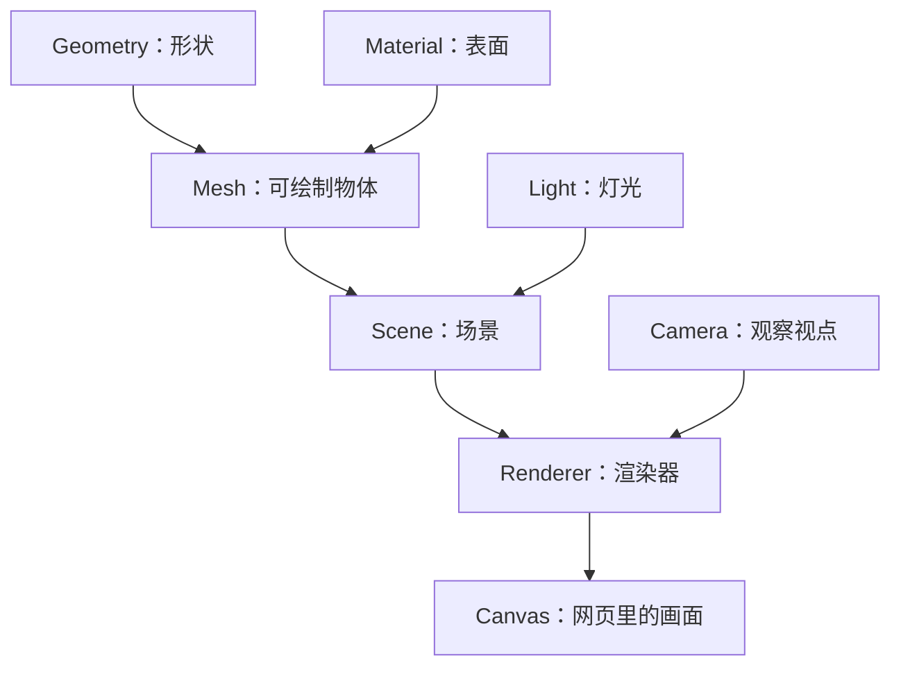

# 三维学习笔记

这是一份持续更新的复习笔记。学习起点：熟悉 React、Next.js，没有三维开发基础。

每次在本项目学习后，在同一份文档里按学习日期追加内容；同一天补充到当天章节。先解释“它是什么、用来干什么”，再对应代码，最后留几个小实验和复习问题。这里只记录已经讲过的内容，不把计划学习的内容写成已经掌握。

> 学习日期和整理日期分开：下面记录的是 2026-10-27 的学习内容，于 2026-10-28 整理。没有学习内容的日期不补写虚构记录。

## 2026-10-27｜第一次认识网页三维

### 1. 昨天我们做了什么

认识了 Three.js、WebGL、WebGPU 及其关系；根据 React 技术背景选了 R3F；搭建了可运行的入门项目；初步讲解形状、材质、物体、相机、灯光和动画；整理了带语言标注的文档入口。

这些内容是“初步接触”，不要求一天记住所有名字。今天复习时，先抓住这句话：

**在一个空间里摆好物体和灯光，从相机的位置看过去，再把结果画到网页上。**

### 2. 先把它想成拍照

想象你要给桌上的一个球拍照：

- **Scene（场景）**：摆东西的摄影棚，组织物体和灯光。
- **Geometry（几何体）**：球的形状。如果换成盒子，形状就变了。
- **Material（材质）**：球的表面。它可以像塑料，也可以像金属。
- **Mesh（网格物体）**：把形状和材质组合起来的可绘制物体。
- **Camera（相机）**：你从哪里看、朝哪里看。它是虚拟视点，不调用电脑摄像头。
- **Light（灯光）**：从哪里照、照多亮。
- **Renderer（渲染器）**：根据这些信息，计算并绘制画面。
- **Canvas（画布）**：网页里显示画面的区域。



这是帮助理解的简化关系图。相机不一定要放进场景树，渲染器也能用它来观察场景。

### 3. React JSX 怎么变成三维物体

平时写 `<div>`，你描述的是网页元素。在 R3F 中写 `<mesh>`，你描述的是一个 Three.js 物体。

```tsx
<mesh>
  <boxGeometry args={[1, 1, 1]} />
  <meshStandardMaterial color="orange" />
</mesh>
```

读法很简单：**创建一个橙色的立方体，宽、高、深都是 1。**

`boxGeometry` 决定它是盒子；`meshStandardMaterial` 决定表面颜色及光照表现；`mesh` 把两者组合起来。

`args` 是创建这个对象时传入的参数，类似原生 Three.js 构造函数的参数列表。不同几何体的参数含义不同，不能把所有 `args` 都理解成宽、高、深。

这里的 `1` 是三维世界里的长度单位，不是 CSS 的 `1px`。最终在屏幕上占多少像素，还要看相机位置、视角和画布大小。

### 4. 位置、旋转、缩放：摆放物体的三个动作

| 属性 | 通俗理解 | 例子 |
|---|---|---|
| `position` | 把物体搬到哪里 | `position={[2, 0, 0]}`：在父对象坐标系的 x 方向移动到 2 |
| `rotation` | 把物体转向哪里 | `rotation={[0, 1, 0]}`：绕 y 轴转 1 弧度 |
| `scale` | 把物体放大或缩小 | `scale={2}`：各方向放大到两倍 |

`[x, y, z]` 是三维坐标，先粗略记成左右、上下、前后。默认情况下，x 正方向向右、y 正方向向上、z 正方向朝默认相机这一侧；相机改变后，这些方向在屏幕上的表现也会变化。

**子对象的位置相对于父对象。** `<group>` 像一个装物体的文件夹：移动、旋转或缩放这个 group，里面的物体会一起变化。它本身不会画出一个盒子。

项目中的：

```tsx
<group ref={group} position={[0, 1.45, 0]}>
  {/* 物体 */}
</group>
```

是在把整组物体抬高，避免物体陷进底座里。

### 5. 材质面板：同一个形状可以有不同外观

先选择内置球体，再调整右侧参数：

| 参数 | 可以怎么想 | 观察什么 |
|---|---|---|
| `color`（颜色） | 表面的基础颜色 | 绿色变成橙色，形状不变 |
| `metalness`（金属感） | 表面是否像金属 | 反光和明暗表现变化 |
| `roughness`（粗糙度） | 表面有多光滑 | 低值高光更集中，高值高光更散 |
| `wireframe`（线框） | 露出组成表面的网格边线 | 看见形状由许多小三角形组成 |

材质不是一张“保证显示这个颜色”的纸。灯光、观察角度等都会影响最终画面。

昨天介绍过 **Texture（纹理）**：给表面提供颜色、凹凸等细节的图片数据。它和材质不是同一个东西；材质可以使用纹理。模板的内置物体暂时不用纹理。

### 6. 物体自己转，和你围着它看，是两回事

页面的 **自动旋转**改变物体的角度；**鼠标拖动**主要通过 OrbitControls（相机轨道控制器）改变相机的位置和观察方式。

你觉得球“变大了”，可能是物体真的放大了，也可能只是相机靠近了。两者有相似的屏幕效果，改变的东西却不同。

灯光方面，项目有 `ambientLight`（环境光，提供整体照明）和 `directionalLight`（平行光，提供有方向的照明）。我们昨天只初步认识了它们，还没有深入讲光照计算。

### 7. 动画是怎样发生的

动画可以想成连续播放许多张略有不同的照片。一张照片叫一“帧”。

第一帧把物体转一点，下一帧再转一点，连续看就像它一直在转。

项目使用 `useFrame`：在每帧绘制前更新对象。下面是入门用的简化写法：

```tsx
useFrame((_state, delta) => {
  if (group.current) {
    group.current.rotation.y += delta * 0.5;
  }
});
```

`delta` 是距离上一帧过去了多少秒。用它乘以速度，可以让不同帧率下的旋转速度更一致。Three.js 的物体旋转使用弧度；完整一圈是 `2 * Math.PI`，暂时记住它不是角度值即可。

项目实际代码还会检查自动旋转开关，并限制过大的 `delta`，避免长时间切回页面时突然转动一大截。

沿用你熟悉的 React 分工：

- 用户选球体还是盒子、面板是否显示：使用 React `state`。
- 对象每帧转到哪个角度：通过 `ref` 直接修改 Three.js 对象。

**React 组件更新与三维绘制不是同一件事。** 物体可以每帧旋转，而不用让整个 React 组件每帧重新执行。

### 8. 那些工具各负责什么

| 工具 | 在这个项目里负责什么 |
|---|---|
| Vite | 启动开发服务器、热更新、构建项目 |
| React | 组织界面、组件、状态和事件 |
| Three.js | 提供物体、材质、相机和渲染等三维能力 |
| R3F（React Three Fiber，React 的 Three.js 渲染器） | 让你用 React JSX 创建、组织和更新三维对象 |
| Drei（常用三维辅助组件库） | 提供鼠标控制、模型加载等现成工具 |
| Leva（参数面板工具） | 用滑块、颜色选择器调整参数 |
| r3f-perf（性能面板工具） | 观察 FPS（每秒帧数）、绘制调用等指标 |
| WebGL | 当前渲染器调用浏览器图形能力的接口 |
| WebGPU | 更现代的图形与通用并行计算接口，模板还没有使用 |
| GPU（图形处理器） | 执行大量并行计算，处理绘图任务 |

Three.js、WebGL 和 WebGPU 不在同一层。Three.js 可以通过对应渲染器使用这些底层接口；你先学 Three.js/R3F，不需要先精通 WebGL。

### 9. 模型文件又是什么

内置球体、盒子可以直接用代码创建。鞋子、人物、汽车这样的复杂形状，通常用 Blender（三维建模软件）制作，再导出文件供网页加载。

昨天初步认识了 glTF（三维模型交换格式）和它的二进制形式 GLB。它们可以保存模型、材质和动画等内容；模板用 `useGLTF` 加载 GLB。

当前导入示例保留模型原始材质，所以右侧材质参数只作用于内置几何体；模型自带动画也不会自动播放。这些加载细节后面再展开。

### 10. 想复习时，去项目哪里看

| 文件 | 先关注什么 |
|---|---|
| [App.tsx](src/App.tsx) | 选择对象、显示面板；这是熟悉的 React 界面逻辑 |
| [useSceneControls.ts](src/hooks/useSceneControls.ts) | `useSceneControls()` 返回参数，Leva 面板可以修改这些值 |
| [Scene.tsx](src/components/Scene.tsx) | `Canvas`、相机、灯光、底座和 `OrbitControls` |
| [Model.tsx](src/components/Model.tsx) | `<mesh>` 内的形状和材质；`useFrame` 中的旋转 |

看到 `torusKnotGeometry`（环面结几何体）时，先知道它是创建当前打结形状的对象即可。它的四个参数还没有详细讲解，不用现在硬记。

### 11. 五分钟复习实验

运行 `npm run dev`，打开终端打印的地址，每次只改一件事：

1. 选择球体，再选择立方体：观察形状变化，材质参数仍然沿用原来的值。
2. 选择球体，只改颜色：确认表面变了，形状没变。
3. 保持金属感不变，把粗糙度从低值调到高值：观察高光由集中变得更分散。
4. 关闭自动旋转，再拖动鼠标：观察“物体不再自己转，但我仍能围着它看”。
5. 打开线框：看看曲面是如何由许多小三角形拼出来的。

这些是建议练习，不代表已经完成。

### 12. 自己能回答这五题，就先过这一关

1. 球变成盒子，改变的是形状还是材质？
2. 绿色球变成橙色球，改变的是什么？
3. `position={[0, 1, 0]}` 是沿哪个方向移动？这里的 1 是像素吗？
4. 自动旋转与鼠标拖动，分别主要改变谁？
5. `useFrame` 是用来做什么的？为什么旋转速度要乘 `delta`？

参考答案：①形状；②材质的颜色；③父对象坐标系的 y 方向，1 是世界长度单位；④物体角度、相机观察位置；⑤每帧更新对象，乘时间间隔让速度更一致。

### 13. 文档先看哪一份

先读 [Three.js《基础》【中文，官方站点手册】](https://threejs.org/manual/zh/fundamentals.html)，理解场景、相机、形状和材质。它使用原生 Three.js 写法，概念可以对应到本项目的 JSX。

再读 [R3F《入门介绍》【英文，官方文档】](https://r3f.docs.pmnd.rs/getting-started/introduction)，了解这些对象怎么用 React 表达。

也可以辅助阅读 [R3F 安装与入门【中文，部分标题英文，社区翻译】](https://fiber.framer.wiki/installation)，但安装和版本配对以官方为准。

其余文档及语言、来源标注，集中放在 [README 的文档部分](README.md#文档)。后续新增文档链接也要标明语言和来源。

### 14. 接下来可以学什么（尚未展开）

- 用一个立方体具体练习位置、旋转和缩放。
- 理解不同几何体的 `args` 参数，不再把它当成神秘数字。
- 区分相机的位置、看向的目标和视野范围。
- 逐步拆解当前 `Model.tsx`，先看内置物体，再看模型加载。

一次学一个小问题，做出能观察的变化，再回笔记复习。
