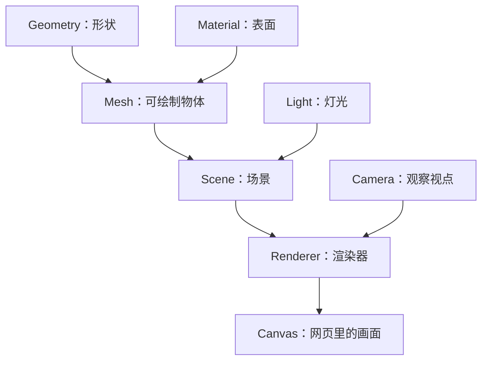
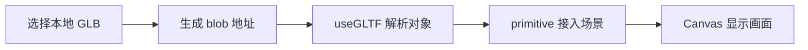

# 三维学习笔记

这是一份持续更新的复习笔记。学习起点：熟悉 React、Next.js，没有三维开发基础。

每次在本项目学习后，在同一份文档里按学习日期追加内容；同一天补充到当天章节。先解释“它是什么、用来干什么”，再对应代码，最后留几个小实验和复习问题。这里只记录已经讲过的内容，不把计划学习的内容写成已经掌握。

> 学习日期和整理日期分开：下面记录的是 2026-10-27 的学习内容，于 2026-10-28 整理。没有学习内容的日期不补写虚构记录。

## 2026-10-27｜第一次认识网页三维

### 1. 昨天我们做了什么

认识了 Three.js、WebGL、WebGPU 及其关系；根据 React 技术背景选了 R3F；搭建了可运行的入门项目；初步讲解形状、材质、物体、相机、灯光和动画；整理了带语言标注的文档入口。

这些内容是“初步接触”，不要求一天记住所有名字。今天复习时，先抓住这句话：

**在一个空间里摆好物体和灯光，从相机的位置看过去，再把结果画到网页上。**

### 2. 先把它想成拍照

想象你要给桌上的一个球拍照：

- **Scene（场景）**：摆东西的摄影棚，组织物体和灯光。
- **Geometry（几何体）**：球的形状。如果换成盒子，形状就变了。
- **Material（材质）**：球的表面。它可以像塑料，也可以像金属。
- **Mesh（网格物体）**：把形状和材质组合起来的可绘制物体。
- **Camera（相机）**：你从哪里看、朝哪里看。它是虚拟视点，不调用电脑摄像头。
- **Light（灯光）**：从哪里照、照多亮。
- **Renderer（渲染器）**：根据这些信息，计算并绘制画面。
- **Canvas（画布）**：网页里显示画面的区域。



这是帮助理解的简化关系图。相机不一定要放进场景树，渲染器也能用它来观察场景。

### 3. React JSX 怎么变成三维物体

平时写 `<div>`，你描述的是网页元素。在 R3F 中写 `<mesh>`，你描述的是一个 Three.js 物体。

```tsx
<mesh>
  <boxGeometry args={[1, 1, 1]} />
  <meshStandardMaterial color="orange" />
</mesh>
```

读法很简单：**创建一个橙色的立方体，宽、高、深都是 1。**

`boxGeometry` 决定它是盒子；`meshStandardMaterial` 决定表面颜色及光照表现；`mesh` 把两者组合起来。

`args` 是创建这个对象时传入的参数，类似原生 Three.js 构造函数的参数列表。不同几何体的参数含义不同，不能把所有 `args` 都理解成宽、高、深。

这里的 `1` 是三维世界里的长度单位，不是 CSS 的 `1px`。最终在屏幕上占多少像素，还要看相机位置、视角和画布大小。

### 4. 位置、旋转、缩放：摆放物体的三个动作

| 属性 | 通俗理解 | 例子 |
|---|---|---|
| `position` | 把物体搬到哪里 | `position={[2, 0, 0]}`：在父对象坐标系的 x 方向移动到 2 |
| `rotation` | 把物体转向哪里 | `rotation={[0, 1, 0]}`：绕 y 轴转 1 弧度 |
| `scale` | 把物体放大或缩小 | `scale={2}`：各方向放大到两倍 |

`[x, y, z]` 是三维坐标，先粗略记成左右、上下、前后。默认情况下，x 正方向向右、y 正方向向上、z 正方向朝默认相机这一侧；相机改变后，这些方向在屏幕上的表现也会变化。

**子对象的位置相对于父对象。** `<group>` 像一个装物体的文件夹：移动、旋转或缩放这个 group，里面的物体会一起变化。它本身不会画出一个盒子。

项目中的：

```tsx
<group ref={group} position={[0, 1.45, 0]}>
  {/* 物体 */}
</group>
```

是在把整组物体抬高，避免物体陷进底座里。

### 5. 材质面板：同一个形状可以有不同外观

先选择内置球体，再调整右侧参数：

| 参数 | 可以怎么想 | 观察什么 |
|---|---|---|
| `color`（颜色） | 表面的基础颜色 | 绿色变成橙色，形状不变 |
| `metalness`（金属感） | 表面是否像金属 | 反光和明暗表现变化 |
| `roughness`（粗糙度） | 表面有多光滑 | 低值高光更集中，高值高光更散 |
| `wireframe`（线框） | 露出组成表面的网格边线 | 看见形状由许多小三角形组成 |

材质不是一张“保证显示这个颜色”的纸。灯光、观察角度等都会影响最终画面。

昨天介绍过 **Texture（纹理）**：给表面提供颜色、凹凸等细节的图片数据。它和材质不是同一个东西；材质可以使用纹理。模板的内置物体暂时不用纹理。

### 6. 物体自己转，和你围着它看，是两回事

页面的 **自动旋转**改变物体的角度；**鼠标拖动**主要通过 OrbitControls（相机轨道控制器）改变相机的位置和观察方式。

你觉得球“变大了”，可能是物体真的放大了，也可能只是相机靠近了。两者有相似的屏幕效果，改变的东西却不同。

灯光方面，项目有 `ambientLight`（环境光，提供整体照明）和 `directionalLight`（平行光，提供有方向的照明）。我们昨天只初步认识了它们，还没有深入讲光照计算。

### 7. 动画是怎样发生的

动画可以想成连续播放许多张略有不同的照片。一张照片叫一“帧”。

第一帧把物体转一点，下一帧再转一点，连续看就像它一直在转。

项目使用 `useFrame`：在每帧绘制前更新对象。下面是入门用的简化写法：

```tsx
useFrame((_state, delta) => {
  if (group.current) {
    group.current.rotation.y += delta * 0.5;
  }
});
```

`delta` 是距离上一帧过去了多少秒。用它乘以速度，可以让不同帧率下的旋转速度更一致。Three.js 的物体旋转使用弧度；完整一圈是 `2 * Math.PI`，暂时记住它不是角度值即可。

**这里的 `rotation.y` 是绕 y 轴旋转的角度，不是高度，也不是逐渐减慢。** 想象站在原地转身：脚的位置不变，朝向一直变化。这个例子更新的是整个 `group`，所以组里的物体会跟着一起转。

| 写法 | 意思 | 直观比喻 |
|---|---|---|
| `rotation.y += delta * 0.5` | 绕 y 轴旋转，每秒增加 0.5 弧度 | 站在原地转身 |
| `position.y += delta * 0.5` | 沿 y 轴移动，每秒增加 0.5 长度单位 | 乘电梯向上 |
| `rotation.x` / `rotation.z` | 分别绕 x / z 轴旋转 | 换一根轴来转 |
| `position.x` / `position.z` | 分别沿 x / z 轴移动 | 换一个方向移动 |

这些轴按对象的父级/局部坐标关系理解；当前例子中 y 轴是竖直方向。

`+=` 表示“在原来数值上继续增加”，`0.5` 是固定的旋转速度。它乘 `delta` 是因为 **这帧转多少 = 每秒转多少 × 这帧经过多少秒**：

- 假设每秒 60 帧，`delta` 约为 `1/60`，每帧转 `0.5/60` 弧度。
- 假设每秒 30 帧，`delta` 约为 `1/30`，每帧转 `0.5/30` 弧度。
- 每帧转的量不同，但两种情况下，一秒都大约转 0.5 弧度。小数相乘让单帧变化很小，是为了连续运动，不代表速度越来越慢。

项目实际代码还会检查自动旋转开关，并限制过大的 `delta`，避免长时间切回页面时突然转动一大截。

沿用你熟悉的 React 分工：

- 用户选球体还是盒子、面板是否显示：使用 React `state`。
- 对象每帧转到哪个角度：通过 `ref` 直接修改 Three.js 对象。

**React 组件更新与三维绘制不是同一件事。** 物体可以每帧旋转，而不用让整个 React 组件每帧重新执行。

### 8. 那些工具各负责什么

| 工具 | 在这个项目里负责什么 |
|---|---|
| Vite | 启动开发服务器、热更新、构建项目 |
| React | 组织界面、组件、状态和事件 |
| Three.js | 提供物体、材质、相机和渲染等三维能力 |
| R3F（React Three Fiber，React 的 Three.js 渲染器） | 让你用 React JSX 创建、组织和更新三维对象 |
| Drei（常用三维辅助组件库） | 提供鼠标控制、模型加载等现成工具 |
| Leva（参数面板工具） | 用滑块、颜色选择器调整参数 |
| r3f-perf（性能面板工具） | 观察 FPS（每秒帧数）、绘制调用等指标 |
| WebGL | 当前渲染器调用浏览器图形能力的接口 |
| WebGPU | 更现代的图形与通用并行计算接口，模板还没有使用 |
| GPU（图形处理器） | 执行大量并行计算，处理绘图任务 |

Three.js、WebGL 和 WebGPU 不在同一层。Three.js 可以通过对应渲染器使用这些底层接口；你先学 Three.js/R3F，不需要先精通 WebGL。

### 9. 模型文件又是什么

内置球体、盒子可以直接用代码创建。鞋子、人物、汽车这样的复杂形状，通常用 Blender（三维建模软件）制作，再导出文件供网页加载。

昨天初步认识了 glTF（三维模型交换格式）和它的二进制形式 GLB。它们可以保存模型、材质和动画等内容；模板用 `useGLTF` 加载 GLB。

当前导入示例保留模型原始材质，所以右侧材质参数只作用于内置几何体；模型自带动画也不会自动播放。这些加载细节后面再展开。

### 10. 想复习时，去项目哪里看

| 文件 | 先关注什么 |
|---|---|
| [App.tsx](src/App.tsx) | 选择对象、显示面板；这是熟悉的 React 界面逻辑 |
| [useSceneControls.ts](src/hooks/useSceneControls.ts) | `useSceneControls()` 返回参数，Leva 面板可以修改这些值 |
| [Scene.tsx](src/components/Scene.tsx) | `Canvas`、相机、灯光、底座和 `OrbitControls` |
| [Model.tsx](src/components/Model.tsx) | `<mesh>` 内的形状和材质；`useFrame` 中的旋转 |

看到 `torusKnotGeometry`（环面结几何体）时，先知道它是创建当前打结形状的对象即可。它的四个参数还没有详细讲解，不用现在硬记。

### 11. 五分钟复习实验

运行 `npm run dev`，打开终端打印的地址，每次只改一件事：

1. 选择球体，再选择立方体：观察形状变化，材质参数仍然沿用原来的值。
2. 选择球体，只改颜色：确认表面变了，形状没变。
3. 保持金属感不变，把粗糙度从低值调到高值：观察高光由集中变得更分散。
4. 关闭自动旋转，再拖动鼠标：观察“物体不再自己转，但我仍能围着它看”。
5. 打开线框：看看曲面是如何由许多小三角形拼出来的。

这些是建议练习，不代表已经完成。

### 12. 自己能回答这五题，就先过这一关

1. 球变成盒子，改变的是形状还是材质？
2. 绿色球变成橙色球，改变的是什么？
3. `position={[0, 1, 0]}` 是沿哪个方向移动？这里的 1 是像素吗？
4. 自动旋转与鼠标拖动，分别主要改变谁？
5. `useFrame` 是用来做什么的？为什么旋转速度要乘 `delta`？

参考答案：①形状；②材质的颜色；③父对象坐标系的 y 方向，1 是世界长度单位；④物体角度、相机观察位置；⑤每帧更新对象，乘时间间隔让速度更一致。

### 13. 文档先看哪一份

先读 [Three.js《基础》【中文，官方站点手册】](https://threejs.org/manual/zh/fundamentals.html)，理解场景、相机、形状和材质。它使用原生 Three.js 写法，概念可以对应到本项目的 JSX。

再读 [R3F《入门介绍》【英文，官方文档】](https://r3f.docs.pmnd.rs/getting-started/introduction)，了解这些对象怎么用 React 表达。

也可以辅助阅读 [R3F 安装与入门【中文，部分标题英文，社区翻译】](https://fiber.framer.wiki/installation)，但安装和版本配对以官方为准。

其余文档及语言、来源标注，集中放在 [README 的文档部分](README.md#文档)。后续新增文档链接也要标明语言和来源。

### 14. 接下来可以学什么（尚未展开）

- 用一个立方体具体练习位置、旋转和缩放。
- 理解不同几何体的 `args` 参数，不再把它当成神秘数字。
- 区分相机的位置、看向的目标和视野范围。
- 逐步拆解当前 `Model.tsx`，先看内置物体，再看模型加载。

一次学一个小问题，做出能观察的变化，再回笔记复习。

## 2026-10-28｜Vite、React 和页面渲染方式

### 1. 当前项目怎么创建的

这个项目是 Vite + React + TypeScript，使用 CSR（Client-Side Rendering，客户端渲染），不是 CRA（Create React App）或 Next.js。

实际搭建时，我们直接创建了配置和源码文件，再通过 `npm install` 安装依赖，没有运行 `create-vite` 脚手架命令。结构相当于以 Vite 的 React TypeScript 模板为基础，再加入三维相关库。

通常新建同类项目可以运行：

```bash
npm create vite@latest my-app -- --template react-ts
```

这是介绍常用创建方式，不是要求在当前目录重新执行。

### 2. Vite 集成了 React 吗

Vite 是开发和构建工具，React 是界面库，它们是分别安装、一起配合的依赖。Vite 提供 React 模板，所以创建时能直接选 React；这不表示 React 是 Vite 内置的一部分。

- `react` 和 `react-dom`：创建组件界面，并把它挂载到浏览器页面。
- `vite`：启动开发服务器、处理模块和打包资源。
- `@vitejs/plugin-react`：为 React 开发接入相应转换和 Fast Refresh（快速刷新，编辑组件时尽可能保留状态）。

本项目的 `vite.config.ts` 通过 `plugins: [react()]` 启用这个插件。

### 3. CSR 和 SSR 分别在什么地方工作

**CSR（Client-Side Rendering，客户端渲染）**：服务器把 HTML 外壳和 JavaScript 发给浏览器，浏览器执行 React，创建主要页面内容。像给浏览器送来零件和说明书，让它现场组装。

本项目的 `index.html` 只有一个空的应用容器：

```html
<div id="root"></div>
```

浏览器加载 `src/main.tsx` 后执行：

```tsx
createRoot(document.getElementById('root')!).render(<App />);
```

于是 React 把页面内容放进 `root`。完整入口还包了一层 `StrictMode`，这里为方便理解省略。

#### HTML、JavaScript 和 React 是一起执行吗？

它们配合工作，但 React 本身就是 JavaScript 库，并不是浏览器里的第三种执行语言。

1. 浏览器先解析 HTML，建立 DOM（Document Object Model，文档对象模型），其中有一个空的 `root` 容器。
2. 浏览器发现脚本入口，加载相关 JavaScript。Vite 会把 `.tsx` 转换成浏览器能执行的 JavaScript；浏览器不会直接执行 TypeScript 或 JSX。
3. JavaScript 执行入口代码，调用 React 和 React DOM，把 `<App />` 描述的界面创建到 `root` 中。
4. 浏览器结合 CSS 进行布局和绘制，你就看到内容了。

可以记成：**HTML 提供初始容器，JavaScript 调用 React 创建内容，CSS 决定样式，浏览器负责显示。** 这里描述的是本项目主要内容的生成顺序，实际资源加载可以并行进行。

**SSR（Server-Side Rendering，服务端渲染）**：服务器先生成带页面内容的 HTML，再发送给浏览器。像把组装好的结构送过来，让浏览器先显示。React 中需要交互的部分随后进行 hydration（水合），把客户端逻辑接到已有 HTML 上。

有开发服务器，不等于使用 SSR。`npm run dev` 启动的 Vite 服务，在本项目里负责发送和转换代码，没有在服务器上生成 `<App />` 的内容 HTML。

### 4. 和 Next.js 怎么对应

Next.js 是基于 React 的框架，可以结合 SSR、SSG（Static Site Generation，静态站点生成）和客户端渲染等方式，具体取决于路由和配置；不能简单把所有 Next.js 页面都归为 SSR。

Vite 也支持搭建 SSR，但当前项目没有配置这套流程，不能仅凭使用 Vite 就推断所有 Vite 项目都只支持 CSR。

页面 HTML 的渲染方式，与三维画面的 GPU（图形处理器）绘制是两层概念。即使以后把场景接入 Next.js，常规 WebGL 三维画面仍在浏览器里绘制，页面外围内容则可以在服务器预先生成。

### 5. 复习题

1. Vite 与 React 分别负责什么？
2. 本项目最初返回的 `root` 里有应用内容吗？谁把内容放进去？
3. 启动了 Vite 开发服务器，是否就等于 SSR？

参考答案：①开发/构建工具与界面库；②没有，浏览器执行 React 后创建；③不等于，要看有没有服务端生成应用内容 HTML 的流程。

### 6. 为什么只绕 y 轴转，却看起来像环绕？

**绕一根轴旋转，本来就会让轴外的点绕它画圆。** 想象转盘中间插着一根竖直的杆子：转盘只绕这根杆子转，但边缘上的每一点都在走圆圈。这就是绕 y 轴旋转，并不需要同时改 x、y、z 三个旋转值。

从上方看，绕竖直 y 轴旋转的点在 x-z 平面画圆；点的高度可以不变，而左右、前后的位置同时变化。之前说“绕 y 轴转”，不能理解成“只有 y 坐标变化”：`rotation.y` 设置绕哪根轴转，`position.y` 才设置高度位置。

当前代码还包含两种不同的运动：

| 触发方式 | 实际改变 | 比喻 |
|---|---|---|
| 自动旋转 | `Model.tsx` 里的 `group.rotation.y` | 商品在转盘上自己转 |
| 鼠标左键拖动 | `Scene.tsx` 的 `OrbitControls` 改变相机位置 | 你拿着相机围着商品走 |

`OrbitControls` 没有设置相机的 `autoRotate`。页面中的“自动旋转”控制的是模型；鼠标拖动可以改变相机的水平观察方向和俯仰角，所以能看到顶部、侧面等角度。

当前内置物体位于 group 中心，group 的位置为 `[0, 1.45, 0]`。自动旋转不会让它的中心围着底座跑。子物体另有固定的 `rotation={[0.15, 0, 0]}`，表示预先绕 x 轴倾斜一点，不是每帧绕 x 轴转。

截图是一张静止画面，不能仅凭它判断运动来自哪里。尤其是没有花纹的球，从哪个方向看都很像，自动旋转很难辨认。灯光高光是光照效果，不是粘在球面上的标记。

**辨认小实验：**切换到立方体，关闭自动旋转，松开鼠标等画面稳定，再拖动。此时改变的是相机；停止拖动，重新开启自动旋转，此时改变的是物体朝向。观察底座和地面：相机移动时，它们的观察角度也会一起变化。

### 7. Model 的入参，以及注释动画后为什么还能拖动

`Model({ shape, modelUrl, controls })` 是 React 组件接收并解构 props（父组件传来的参数），和普通 React 组件的入参一样：

- `shape`：选择内置形状，`knot` 是扭结、`cube` 是立方体、`sphere` 是球体。
- `modelUrl`：导入模型的加载地址；`null` 表示没有导入，使用内置形状。有地址时优先展示导入模型，`shape` 暂时不参与显示。
- `controls`：参数面板的设置对象，包含颜色、金属感、粗糙度、线框和自动旋转等设置。当前实现中，导入模型使用自己的材质，内置形状使用面板材质设置。

**注释 `useFrame` 只关掉“物体自动转”，不会关掉“鼠标移动相机”。** `Scene.tsx` 的 `<OrbitControls />` 仍然处理拖动，所以你还能围着静止物体观察。像停掉转盘的电机，你仍能拿着相机围着商品走。

如果也想禁止鼠标拖动旋转，可以给相机控制加：

```tsx
<OrbitControls enableRotate={false} /* 其余参数保持原样 */ />
```

这只关闭拖动旋转；缩放和平移是另外的功能。当前项目没有添加这个参数，仍保留鼠标观察操作。

`rotation={[0.15, 0, 0]}` 是固定的初始倾斜，不会让物体自己一直转。注释动画代码后，面板中的自动旋转开关和速度也不再生效；要恢复自动旋转，需要同时恢复 `useFrame` 的导入与回调代码。

如果没有操作鼠标，保存并刷新后仍然一直运动，这就不能仅用拖动相机来解释，需要继续确认运行页面是否加载了最新代码。松手后短暂的相机缓动则可能是控制器的阻尼效果。

### 8. GLB 是什么，怎样导入并展示

**GLB 是保存三维模型的文件格式，可以把它想成一个打包好的三维作品。** glTF（GL Transmission Format，三维资产传输格式）描述物体形状、材质、纹理、层级和动画等数据；`.glb` 是它的二进制容器形式。

常见的 `.gltf` 文件是 JSON（结构化文本数据），可能搭配独立的 `.bin` 数据文件和纹理图片；`.glb` 通常把这些资源放进一个文件，便于传递。GLB 也可能引用外部资源，所以“扩展名是 GLB”不保证所有资源都已内嵌。

GLB 保存的是可以从不同角度观察的三维数据，不是一张照片，也不是 React 组件。Blender（三维建模软件）可以制作模型，再导出 GLB 交给网页加载。动画可以存在文件里，但当前代码只展示模型，没有播放文件动画。

#### 当前“导入”是本地读取

项目 `App.tsx` 的流程：

1. `<input type="file" accept=".glb">` 打开系统文件选择窗口，用户选择后取得 `File` 对象。`accept` 是选择提示，代码还会检查扩展名与文件大小；是否真的是有效模型由加载器继续判断。
2. `importModel` 检查扩展名和 30 MB 大小限制。
3. `URL.createObjectURL(file)` 创建 `blob:` 开头的临时地址，让加载器能读取浏览器选中的文件。
4. `setModel` 保存地址和文件名；地址通过 `Scene` 传到 `Model` 的 `modelUrl`。
5. `Model` 发现有地址，就展示 `ImportedModel`，替代内置球体或立方体。

```tsx
const file = event.target.files?.[0];
// 省略当前代码里的检查
setModel({ url: URL.createObjectURL(file), name: file.name });
```

**创建 blob 地址不会把文件上传服务器。** 当前项目没有发送文件的上传接口，刷新后也不会保留这次导入。以后若要多人共享或长期保存，需要另做上传接口和文件存储，再用服务器提供的地址加载。

切换模型、退出导入模式或卸载时，现有 effect 会撤销旧的临时地址，并清除对应 `useGLTF` 加载缓存；这不等于已经深度释放所有显存资源。

#### useGLTF 和 primitive 分别负责什么

`useGLTF` 是 Drei 的模型加载工具：读取地址中的文件，把三维数据解析成 Three.js 对象。

```tsx
const { scene } = useGLTF(url, false);
```

这里的 `scene` 是模型文件解析出来的场景根对象，可能包含很多 mesh（网格物体），不是网页 DOM（文档对象模型）元素。第二个参数 `false` 关闭 Draco（三维几何压缩技术）解码器支持；本模板建议使用未压缩、资源内嵌的 GLB。

`primitive` 是 R3F（React Three Fiber，React 的 Three.js 渲染器）用来**接入已经创建好的 Three.js 对象**的 JSX 入口：

```tsx
// 便于理解的最简展示写法，不是当前完整实现
<primitive object={scene} />
```

`object` 是实际的 Three.js 对象。`primitive` 不负责读取 GLB，也不是把它变成 HTML 标签。可以对比：

- `<mesh><boxGeometry />...</mesh>`：用 JSX 描述并创建一个新物体。
- `<primitive object={scene} />`：将加载器已经创建的对象树接入当前三维场景。

接入后，仍由当前场景的相机、灯光和渲染器一起决定画面。



#### 为什么当前代码还会居中和缩放

不同模型的原始尺寸和位置不一样，直接接入可能太大、太小或跑出视野。`Model.tsx` 的完整实现还会：

1. `scene.clone(true)`：复制对象层级，避免直接调整缓存里的原始对象；几何体和材质仍可能共享。
2. `traverse`：遍历部件，设置投射和接收阴影。
3. `Box3`：计算包住整个模型的盒子，取得尺寸和中心。
4. `scale = 2 / 最长边`：把最长边统一缩放到 2 个世界长度单位。
5. `position = -中心 × scale`：把缩放后的模型中心移到父级原点。

最后把复制出的 `object` 交给 `<primitive>`，并传入 `scale` 和 `position`。外层 group 再把整组模型抬到 `[0, 1.45, 0]`。

`dispose={null}` 表示关闭这棵子树的自动资源销毁，避免卸载时销毁缓存共享资源；它和模型文件解析、显示是不同的事情。

#### 建议练习：导入小机器人

示例文件：[彩色机器人模型【GLB 二进制模型，项目自制】](sample-robot.glb)。它约 3.7 KB，有 15 个部件，包含自己的彩色材质，没有外部纹理、Draco 压缩或文件动画。已使用 Three.js 的 `GLTFLoader` 验证可解析，尚未记录浏览器画面验证。

1. 打开当前项目页面，点击左侧“导入本地 GLB”，选择项目根目录的 `sample-robot.glb`。
2. 观察内置物体被机器人替代，左侧出现当前文件名。
3. 拖动鼠标观察背面，滚轮缩放；关闭自动旋转后再拖动，区分物体旋转和相机移动。
4. 调整右侧颜色：当前导入模型保持自带材质；切回内置立方体后，材质面板才影响它。
5. 刷新页面，观察导入状态不会保留。

这些是建议练习，不表示你已经完成。若自动旋转回调仍被手动注释，自动旋转开关不会生效，鼠标观察仍可使用。

#### 复习题

1. GLB 是照片还是三维数据？它可以保存哪些内容？
2. `URL.createObjectURL(file)` 会上传文件吗？
3. `useGLTF` 和 `primitive` 谁解析文件、谁接入对象？
4. 导入后模型的颜色为什么不随当前材质面板变化？

参考答案：①三维数据，可包含形状、材质、纹理、层级和动画等；②不会，只创建本地临时读取地址；③前者解析，后者接入对象；④当前实现保留模型自己的材质。

### 9. Blob、图片视频预览，以及真正的上传

**Blob（Binary Large Object，二进制大对象）可以理解成浏览器里的“数据包”。** 图片、视频、GLB、文本等内容都可以装进去；名字里有“大”，但数据并不必须很大。Blob 对象本身并不说明内容一定是图片或视频。

用户通过文件选择框选中的 `File` 对象是 Blob 的一种，额外带有文件名、最后修改时间等信息。因此当前项目可以直接把 `file` 交给 `URL.createObjectURL`。

区分三个东西：

| 名称 | 通俗理解 | 用途 |
|---|---|---|
| `Blob` | 装着内容的数据包 | 表示文件数据 |
| `File` | 带文件名等信息的数据包 | 表示用户选中的文件 |
| `blob:` 地址 | 浏览器发给数据包的临时取件号码 | 让图片、视频元素或模型加载器读取数据 |

`URL.createObjectURL(file)` 返回的是地址字符串，不是 Blob 本身，也不是电脑磁盘路径。它不把文件转成另一种格式，不上传文件，也不创建可供别人长期访问的网络链接。

#### 图片和视频也能先在本地预览

```tsx
const url = URL.createObjectURL(file);
// 图片文件：
// 视频文件：<video src={url} controls />
// GLB 文件：useGLTF(url, false)
```

这些使用相同的临时地址机制，但由不同工具解析内容：图片元素解析图片，视频元素解析视频，模型加载器解析 GLB。视频能否播放还取决于浏览器是否支持文件里的编码，不能仅靠扩展名保证。

上面是解释用的片段，不是完整组件。实际 React 组件应在文件改变时创建地址，在旧预览不再使用或组件卸载后通过 `URL.revokeObjectURL(url)` 撤销地址；不要每次 render 都创建新地址，也不要刚设置预览就立即撤销。撤销地址不会删除电脑上的原文件。

#### 真正上传时，发送的是文件数据

```tsx
// 假设服务端已经实现 /api/upload；当前项目没有这个接口。
const form = new FormData();
form.append("file", file);
const response = await fetch("/api/upload", {
  method: "POST",
  body: form,
});
if (!response.ok) throw new Error("上传失败");
```

`FormData`（表单数据对象）把文件放进请求体，`fetch` 才通过网络发送。让浏览器自动生成这类请求的 `Content-Type`（内容类型）及 multipart 边界，不手动设置。服务端接收并保存后，可以按接口约定返回可访问的地址，页面再用它显示图片或播放视频。

预览和上传是两个独立步骤：可以先预览再上传，也可以同时进行。把 `blob:` 地址字符串发给服务器，服务器不能凭这个字符串读取用户浏览器里的文件；应该发送 `File` 或 Blob 的实际内容。

#### 建议练习与复习题

建议练习：在独立的图片选择示例里生成 blob 地址并显示图片，观察无需上传接口也能预览；替换文件时撤销旧地址。这不是要求修改当前 GLB 导入功能，也不表示练习已完成。

1. Blob 和 blob 地址，谁装数据、谁用于访问数据？
2. 选中文件并看到预览，是否表示已经上传？
3. 服务器能否直接读取你发来的 blob 地址字符串？

参考答案：①Blob 装数据，blob 地址用于访问；②不表示，必须有发送文件数据的网络请求；③不能，需要发送实际文件数据。
